  

# 🚀 Awesome Private Team Collaboration Workspaces

  
  
  
  
  
  
  

> 🌟 A curated list of top **Private Team Collaboration Workspace** platforms — featuring SaaS & commercial cloud suites alongside privacy-first, self-hosted open-source alternatives for secure team communication, document management, knowledge sharing, and agile project coordination.

---

## 📑 Table of Contents

- [📈 Sector Overview & Market Dynamics](#-sector-overview--market-dynamics)
- [🏢 SaaS & Hosted Platforms](#-saas--hosted-platforms)
- [💻 Open-Source Software](#-open-source-software)
  - [AppFlowy](#appflowy-)
  - [AFFiNE](#affine-)
  - [Rocket.Chat](#rocketchat-)
  - [Outline](#outline-)
  - [Mattermost](#mattermost-)
  - [Nextcloud Hub](#nextcloud-hub-)
  - [Buzz](#buzz-)
  - [Huly](#huly-)
  - [Zulip](#zulip-)
  - [Element](#element-)
  - [Planka](#planka-)
  - [CryptPad](#cryptpad-)
  - [Colanode](#colanode-)
  - [Sync-in](#sync-in-)
  - [Calab](#calab-)
  - [Folio](#folio-)
  - [OneCamp](#onecamp-)
- [📊 Feature Matrix & Comparison at a Glance](#-feature-matrix--comparison-at-a-glance)
- [🎯 Selection Guide: Choosing the Right Private Workspace](#-selection-guide-choosing-the-right-private-workspace)
- [🤝 Contributing](#-contributing)
- [💖 Support & Sponsorship](#-support--sponsorship)
- [⭐ Star History](#-star-history)
- [📄 License](#-license)

---

## 📈 Sector Overview & Market Dynamics

The global team collaboration software market is estimated between **$20.8 Billion and $44.6 Billion**, projected to exceed **$55 Billion by 2030** with an annual growth rate (CAGR) of 10% to 12%. 

The sector is **moderately fragmented**: mega-cap hyper-scalers (Microsoft, Alphabet, Salesforce) consolidate broad office suites and core channel messaging, while hundreds of specialized and open-source ISVs capture high-growth market share across niche disciplines such as local-first offline wikis, end-to-end encrypted file sharing, and self-hosted private workflows subject to stringent global data residency regulations (GDPR, HIPAA, DORA).

---

## 🏢 SaaS & Hosted Platforms

A comparison of leading commercial cloud collaboration workspaces, sorted by parent company market capitalization and corporate scale (descending).

| 🏢 Platform | 💰 Starting Paid Tier Pricing | 🎁 Free Plan Limits / Trial Limits | 📊 Company Scale (Revenue / Valuation) | 🎯 Primary Focus |
|:---|:---|:---|:---|:---|
| **Microsoft Teams** | **$4.00** /user/month (Teams Essentials, annual commitment) | **Permanent Free Tier:** Personal/Small groups; max 60 min group meetings, up to 100 participants, 5 GB cloud storage per user. Lacks meeting recordings and enterprise admin controls. | **~$3.87 Trillion** Market Cap (Microsoft NASDAQ: MSFT; ~$8B–$10B estimated attributed Teams run-rate) | Enterprise chat, video meetings, and Microsoft 365 ecosystem hub |
| **Google Workspace** | **$7.00** /user/month (Business Starter, annual commitment; $8.40/mo flexible) | **14-day Free Trial:** Full feature access on selected plan capped at up to 10 users during trial. (Google Workspace Essentials Starter is also available for existing domains without custom email). | **~$3.47 Trillion** Market Cap (Alphabet NASDAQ: GOOGL; ~$30B+ Google Cloud run-rate) | Cloud productivity suite (Docs, Sheets, Drive, Meet, Chat spaces) |
| **Slack** | **$7.25** /user/month (Slack Pro, billed annually; $8.75/mo flexible) | **Permanent Free Plan:** 90 days of searchable message & file history (older items hidden; deleted after 1 yr), max 10 app integrations, 1-on-1 huddles only, 5 GB storage. | **$27.7 Billion** Acquisition Valuation (Salesforce NYSE: CRM; >$1.7B Slack ARR) | Real-time channel messaging, huddles, and Slack Connect workflows |
| **Notion** | **$10.00** /user/month (Notion Plus, billed annually; $12.00/mo flexible) | **Permanent Free Plan:** Unlimited blocks & pages for solo users; **strict 1,000 block lifetime cap** for workspaces with 2+ members; 5 MB file upload limit; 7-day page history; 10 guests. | **$11.0 Billion** Valuation (Private; >$600 Million Annual Recurring Revenue) | Flexible docs, structured relational databases, wikis, and teamspaces |
| **Asana** | **$10.99** /user/month (Asana Starter, billed annually; $13.49/mo flexible) | **Permanent Personal Plan:** Capped at **up to 2 users** per workspace; basic List/Board/Calendar views only (no Timeline/Gantt, custom fields, rules, or reporting dashboards); 100 MB per file limit. | **~$2.3 Billion** Market Cap (NYSE: ASAN; ~$800 Million annual revenue) | Work management, task tracking, and cross-functional project portfolios |

---

## 💻 Open-Source Software

Self-hosted, privacy-respecting, and open-source collaboration platforms. Repositories are ranked below in descending order by GitHub stargazer count.

---

### AppFlowy 
- 🔗 **Repository:** [AppFlowy-IO/AppFlowy](https://github.com/AppFlowy-IO/AppFlowy)
- ⚙️ **Stack:** Flutter / Rust / PostgreSQL | 📜 **License:** AGPL-3.0
- 📝 **Overview:** AppFlowy is a privacy-first, open-source alternative to Notion. Built with Flutter and Rust, it provides complete data ownership through local storage and self-hosted cloud sync. Features include rich markdown documents, relational databases, Kanban boards, AI assistance, and offline support.
- 🎯 **Best For:** Individuals and teams seeking a high-performance, native desktop and mobile workspace with uncompromising data ownership.

---

### AFFiNE 
- 🔗 **Repository:** [toeverything/AFFiNE](https://github.com/toeverything/AFFiNE)
- ⚙️ **Stack:** TypeScript / Rust / CRDT / Node.js | 📜 **License:** MIT
- 📝 **Overview:** AFFiNE is a next-generation open-source workspace merging docs, whiteboards, and multimodal databases into a single canvas. Positioned as a unified alternative to Notion and Miro, it utilizes local-first architecture and CRDT algorithms for real-time multiplayer co-editing without cloud lock-in.
- 🎯 **Best For:** Creative and engineering teams needing visual whiteboards seamlessly tied to structured documentation and wikis.

---

### Rocket.Chat 
- 🔗 **Repository:** [RocketChat/Rocket.Chat](https://github.com/RocketChat/Rocket.Chat)
- ⚙️ **Stack:** JavaScript / TypeScript / Node.js / MongoDB | 📜 **License:** MIT
- 📝 **Overview:** Rocket.Chat is an enterprise-grade communications hub supporting team chat, omnichannel customer service, voice and video conferencing, file sharing, and Matrix federation. It provides extensive compliance controls, end-to-end encryption, and LDAP/SAML integrations.
- 🎯 **Best For:** Regulated industries, healthcare, defense, and enterprises needing full control over team chat and omnichannel operations.

---

### Outline 
- 🔗 **Repository:** [outline/outline](https://github.com/outline/outline)
- ⚙️ **Stack:** TypeScript / React / Node.js / PostgreSQL / Redis | 📜 **License:** BSL 1.1 / Open Source
- 📝 **Overview:** Outline is a fast, intuitive knowledge base and documentation platform for growing teams. It features a markdown-first editor, real-time multiplayer editing, nested document hierarchy, fine-grained access control, and integrations with Slack, Figma, and Google Workspace.
- 🎯 **Best For:** Teams that want an ultra-clean, snappy internal knowledge base and documentation wiki.

---

### Mattermost 
- 🔗 **Repository:** [mattermost/mattermost](https://github.com/mattermost/mattermost)
- ⚙️ **Stack:** Go / React / PostgreSQL | 📜 **License:** MIT (Team Edition) / Commercial
- 📝 **Overview:** Mattermost is an open-source messaging platform designed for secure, self-hosted team communication and DevOps coordination. Beyond channels and direct messaging, **Playbooks** provide structured checklists and automated incident workflows directly within chat rooms.
- 🎯 **Best For:** DevSecOps, engineering, and cybersecurity teams requiring audit trails and compliance-ready incident management.

---

### Nextcloud Hub 
- 🔗 **Repository:** [nextcloud/server](https://github.com/nextcloud/server)
- ⚙️ **Stack:** PHP / JavaScript / MariaDB / PostgreSQL / Redis | 📜 **License:** AGPL-3.0
- 📝 **Overview:** Nextcloud Hub is an on-premises content collaboration platform combining Nextcloud Files, Nextcloud Talk (chat and video calls), Nextcloud Groupware (calendar, mail, contacts), and Nextcloud Office (collaborative document editing via Collabora Online or OnlyOffice).
- 🎯 **Best For:** Organizations looking for a complete, self-hosted Google Workspace or Microsoft 365 replacement under their own data center governance.

---

### Buzz 
- 🔗 **Repository:** [block/buzz](https://github.com/block/buzz)
- ⚙️ **Stack:** Rust / Nostr Protocol / PostgreSQL / Redis | 📜 **License:** Apache-2.0
- 📝 **Overview:** Built by Block, Buzz combines team communication, Git repositories, and autonomous AI agent workflows into a single self-hosted relay. Utilizing the decentralized **Nostr protocol**, every interaction—whether from human or AI teammate—is a cryptographically signed event that creates an immutable, verifiable audit log.
- 🎯 **Best For:** Technical and AI-first engineering teams wanting cryptographic identity, transparent agent accountability, and Git-native collaboration.

---

### Huly 
- 🔗 **Repository:** [hcengineering/platform](https://github.com/hcengineering/platform)
- ⚙️ **Stack:** TypeScript / PostgreSQL / Elasticsearch / Redpanda | 📜 **License:** EPL-2.0
- 📝 **Overview:** Huly is an all-in-one open-source digital office and project management platform designed as a self-hosted alternative to Linear, Jira, Slack, and Notion. It bundles project trackers (issues, milestones, sprints), collaborative documents, chat, team calendars, and virtual office spaces.
- 🎯 **Best For:** Software product teams wanting unified issue tracking, chat, and wikis with modern desktop responsiveness.

---

### Zulip 
- 🔗 **Repository:** [zulip/zulip](https://github.com/zulip/zulip)
- ⚙️ **Stack:** Python / Django / TypeScript / PostgreSQL | 📜 **License:** Apache-2.0
- 📝 **Overview:** Zulip is an open-source team chat tool with a unique topic-based threading model. By combining the speed of real-time messaging with the structured asynchronous clarity of email threads, Zulip prevents chatter fatigue and ensures discussions remain organized.
- 🎯 **Best For:** Distributed and asynchronous teams across different time zones that suffer from communication overload in conventional chat rooms.

---

### Element 
- 🔗 **Repository:** [element-hq/element-web](https://github.com/element-hq/element-web)
- ⚙️ **Stack:** TypeScript / React / Matrix Protocol | 📜 **License:** AGPL-3.0
- 📝 **Overview:** Element is a flagship web client built on top of the decentralized **Matrix** protocol. It provides default end-to-end encryption (E2EE), voice/video conferencing, and federated communication across different organizations and private server instances.
- 🎯 **Best For:** Organizations seeking sovereign, federated communication with military-grade end-to-end encryption.

---

### Planka 
- 🔗 **Repository:** [plankanban/planka](https://github.com/plankanban/planka)
- ⚙️ **Stack:** JavaScript / Node.js / React / PostgreSQL | 📜 **License:** AGPL-3.0
- 📝 **Overview:** Planka is an open-source, real-time collaborative Kanban tracking board alternative to Trello. It supports unlimited projects, custom task cards, background customizers, member assignments, file attachments, and OIDC/SSO authentication.
- 🎯 **Best For:** Teams that need a lightweight, self-hosted agile board without complex enterprise bloat.

---

### CryptPad 
- 🔗 **Repository:** [cryptpad/cryptpad](https://github.com/cryptpad/cryptpad)
- ⚙️ **Stack:** JavaScript / Node.js | 📜 **License:** AGPL-3.0
- 📝 **Overview:** CryptPad is a zero-knowledge, **fully end-to-end encrypted** collaboration suite. It provides real-time co-authoring for rich text documents, spreadsheets, code, presentations, forms, and whiteboards where client-side cryptography guarantees that neither hosting providers nor server administrators can read user content.
- 🎯 **Best For:** Privacy-sensitive, legal, civil society, and activist organizations requiring absolute confidentiality.

---

### Colanode 
- 🔗 **Repository:** [colanode/colanode](https://github.com/colanode/colanode)
- ⚙️ **Stack:** TypeScript / PostgreSQL (pgvector) / Redis / S3 | 📜 **License:** Apache-2.0
- 📝 **Overview:** Colanode is an open-source, **local-first** team workspace combining chat channels, relational databases, collaborative pages, and file sharing. Local SQLite instances allow clients to operate fully offline, seamlessly syncing changes via CRDTs once connectivity resumes.
- 🎯 **Best For:** Teams that demand offline-first capability, desktop speed, and complete database self-hosting.

---

### Sync-in 
- 🔗 **Repository:** [Sync-in/server](https://github.com/Sync-in/server)
- ⚙️ **Stack:** Node.js / WebDAV / PostgreSQL | 📜 **License:** AGPL-3.0
- 📝 **Overview:** Sync-in is a sovereign platform for file storage, folder synchronization, and document co-editing. Unlike platforms that obscure storage under opaque database blobs, Sync-in preserves direct readability on host filesystems while offering fine-grained permissions, WebDAV, and Collabora/OnlyOffice co-editing.
- 🎯 **Best For:** Teams prioritizing transparent file storage, document co-editing, and direct filesystem sovereignty.

---

### Calab 
- 🔗 **Repository:** [itrcz/calab](https://github.com/itrcz/calab)
- ⚙️ **Stack:** LiveKit / Node.js / Python / Go / PostgreSQL | 📜 **License:** Open Source
- 📝 **Overview:** Calab is a self-hosted workspace combining chat, WebRTC voice/video calls via LiveKit, task boards, wikis, calendar, and email into one unified deployment. It features workspace-scoped OIDC SSO with LDAPS lifecycle sync and isolated rooms that hide content even from platform admins.
- 🎯 **Best For:** Teams wanting a self-hosted platform with room-level privacy boundaries and integrated video meetings.

---

### Folio 
- 🔗 **Repository:** [evergreen-it-dev/folio](https://github.com/evergreen-it-dev/folio)
- ⚙️ **Stack:** TypeScript / Git-backed / React | 📜 **License:** Open Source
- 📝 **Overview:** Folio is an AI-assisted, Git-native team wiki where documentation resides as plain Markdown files versioned directly in Git repositories. It features real-time collaborative editing, SCIM 2.0 provisioning, and an integrated Model Context Protocol (MCP) server for developer AI agents.
- 🎯 **Best For:** Engineering teams desiring version-controlled documentation in Git alongside automated MCP-enabled AI assistants.

---

### OneCamp 
- 🔗 **Repository:** [OneMana-Soft/OneCamp-fe](https://github.com/OneMana-Soft/OneCamp-fe)
- ⚙️ **Stack:** Go / Next.js / LiveKit / Tiptap / PostgreSQL | 📜 **License:** AGPL-3.0
- 📝 **Overview:** OneCamp is an all-in-one workspace unifying real-time chat, task Kanban boards, multiplayer collaborative docs, whiteboards (Excalidraw), HD video calls, and AI teammates bounded by user permissions.
- 🎯 **Best For:** Organizations seeking a single Docker Compose stack with enterprise authentication (SAML, OIDC, SCIM) and native AI agents.

---

## 📊 Feature Matrix & Comparison at a Glance

| 🛠️ Software | 📜 License | 💻 Primary Stack | 🔒 E2EE Support | 🔑 SSO / Directory Sync | 🏗️ Architecture | 🚀 Deployment Model | 🎯 Primary Focus |
|:---|:---|:---|:---:|:---:|:---:|:---|:---|
| **AppFlowy** | AGPL-3.0 | Flutter / Rust | Optional / Cloud | Enterprise | Local-First / Cloud | Self-Hosted / Cloud | Notion Alternative / Private Docs |
| **AFFiNE** | MIT | TypeScript / Rust | ❌ | Roadmap | Local-First (CRDT) | Self-Hosted / Cloud | Unified Docs + Canvas Whiteboards |
| **Rocket.Chat** | MIT | Node.js / Mongo | ✅ (Omni/Chat) | ✅ SAML / LDAP / OIDC | Client-Server | Self-Hosted / Cloud | Enterprise Team Chat & Customer Comms |
| **Outline** | BSL 1.1 / Open | TypeScript / Postgres | ❌ | ✅ OIDC / SAML / Slack | Client-Server | Self-Hosted / Cloud | Fast Team Knowledge Base & Docs |
| **Mattermost** | MIT / Comm. | Go / Postgres | ❌ | ✅ OIDC / SAML / LDAP | Client-Server | Self-Hosted / Private Cloud | DevSecOps & Incident Chatrooms |
| **Nextcloud Hub** | AGPL-3.0 | PHP / Postgres | ✅ (Files App) | ✅ LDAP / SAML / OIDC | Modular Suite | Self-Hosted / On-Prem | Full Google / M365 Suite Alternative |
| **Buzz** | Apache-2.0 | Rust / Nostr | (Signed Events) | Custom / Nostr Keys | Decentralized Relay | Self-Hosted | AI-Teammates & Cryptographic Audit |
| **Huly** | EPL-2.0 | TS / Postgres | ❌ | Planned | Microservices | Self-Hosted / Cloud | Linear + Slack + Notion Replacement |
| **Zulip** | Apache-2.0 | Python / Django | ❌ | ✅ LDAP / SAML / OIDC | Threaded Streams | Self-Hosted / Cloud | Topic-Threaded Asynchronous Chat |
| **Element** | AGPL-3.0 | Matrix / React | ✅ (Native E2EE)| ✅ OpenID / SAML | Federated (Matrix) | Self-Hosted / Cloud | Federated & Encrypted Messaging |
| **Planka** | AGPL-3.0 | Node.js / Postgres | ❌ | ✅ OIDC | Client-Server | Self-Hosted | Lightweight Agile Kanban Boards |
| **CryptPad** | AGPL-3.0 | JavaScript / Node | ✅ (Zero-Knowledge)| Optional | Client-side Encrypted | Self-Hosted / Web | Zero-Knowledge Document Co-Editing |
| **Colanode** | Apache-2.0 | TS / SQLite / Postgres| ❌ | Community | Local-First (CRDT) | Self-Hosted | Local-First Chat + Notion Hybrid |
| **Sync-in** | AGPL-3.0 | Node.js / WebDAV | ❌ | ✅ OIDC / LDAP / MFA | Filesystem-native | Self-Hosted | Sovereign File Storage & Co-editing |
| **Calab** | Open Source | LiveKit / Postgres | ❌ | ✅ OIDC / LDAPS | Client-Server | Self-Hosted | Private Rooms, Calls & Task Boards |
| **Folio** | Open Source | TypeScript / Git | ❌ | ✅ SCIM 2.0 | Git-Backed Wiki | Self-Hosted | Git-Native Markdown Docs + MCP |
| **OneCamp** | AGPL-3.0 | Go / Next.js | ❌ | ✅ SAML / SCIM | Docker Stack | Self-Hosted | All-in-One Collaboration + AI Agents |

---

## 🎯 Selection Guide: Choosing the Right Private Workspace

To determine the ideal collaboration platform for your team, consider these architectural requirements:

1. 🔒 **Strict End-to-End Encryption (Zero-Trust):** Choose **[CryptPad](#cryptpad-)** for complete zero-knowledge client-side encrypted docs, or **[Element](#element-)** for federated, encrypted chat.
2. ⚡ **Local-First & Offline Resilience:** Choose **[AppFlowy](#appflowy-)**, **[AFFiNE](#affine-)**, or **[Colanode](#colanode-)** to ensure your team can create documents and manage databases without continuous internet connectivity.
3. 🛠️ **Developer & DevSecOps Workflows:** Choose **[Mattermost](#mattermost-)** for incident response playbooks, **[Folio](#folio-)** for Git-versioned documentation, or **[Buzz](#buzz-)** for Nostr-verified AI-agent audit trails.
4. 🏢 **All-in-One Enterprise Hubs:** Choose **[Nextcloud Hub](#nextcloud-hub-)** or **[Huly](#huly-)** if you want to replace multiple disjointed SaaS subscriptions with a single self-hosted server stack.
5. 💬 **Asynchronous Discussion Clarity:** Choose **[Zulip](#zulip-)** to eliminate channel chaos through topic-threaded streams.

---

## 🤝 Contributing

Contributions are warmly welcomed! If you know of an outstanding open-source private collaboration platform or self-hosted workspace that should be added to this list:

1. 🍴 Fork this repository.
2. 🌿 Create a new branch: `git checkout -b feature/add-tool`.
3. ✏️ Add the project with its name, GitHub stargazers social badge, description, technology stack, and primary use case.
4. 🔢 Ensure the repository is sorted correctly by star count.
5. 🚀 Submit a pull request.

---

## 💖 Support & Sponsorship

Thank you so much for exploring and using this curated list! Maintaining and curating quality open-source ecosystems takes time and effort. 

If this repository has helped you discover powerful privacy-first workspace tools for your team or organization, please consider:
- ⭐ **Starring this repository** on GitHub to boost its discoverability!
- 🍴 **Forking and sharing** it with your engineering colleagues and team leads.
- ☕ **Buying a coffee or sponsoring ongoing open-source work** via the [GitHub Sponsor Dashboard](https://github.com/sponsors/ishandutta2007).

Your support is deeply appreciated! 🙌

---

## ⭐ Star History

---

## 📄 License

This curated list is released under the [CC0 1.0 Universal (Public Domain)](https://creativecommons.org/publicdomain/zero/1.0/). Projects listed maintain their respective individual licenses.
